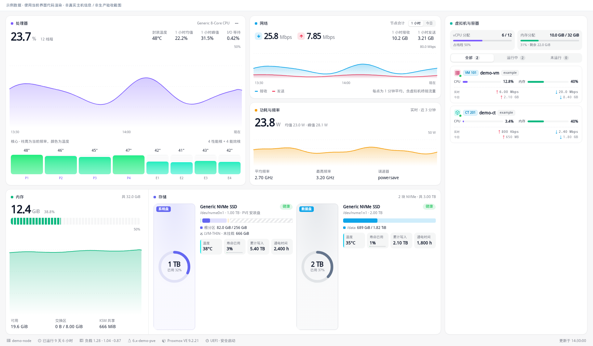

# Proxmox VE 概要看板

Proxmox VE 概要看板是面向节点「概要」页面的非官方扩展，集中展示处理器、内存、NVMe 存储、网络及虚拟机与容器状态。原生 RRD 图表保留在「趋势图」页。

当前版本：`V1.0.0` · 目标环境：Proxmox VE `9.2.x`

已记录的单机部署版本为 `pve-manager 9.2.21`。其他版本及硬件环境需另行验证。

[下载版本](https://github.com/TacitSoul/Proxmox-VE-Summary-Dashboard/releases) · [安装与维护](docs/INSTALLATION.md) · [更新记录](CHANGELOG.md)

## 界面预览



预览图由当前界面代码与示例数据生成，不包含实际主机信息。

## 主要功能

- **处理器与内存**：CPU 使用率与历史趋势、核心频率与温度，以及内存、交换区和 KSM 状态。
- **NVMe 存储**：设备信息、分区与挂载布局、容量使用情况，以及设备支持的 SMART 数据。
- **网络统计**：节点实时速率、近一小时趋势及今日流量。
- **虚拟机与容器**：本节点非模板 VM/CT 的运行状态、资源分配、实时速率和今日流量，提供原生管理页面入口。
- **界面集成**：适配 PVE 深浅主题，提供 CPU 与 NVMe 详情；总览页折叠底部任务日志，离开后恢复。

## 安装

本扩展会修改 PVE 的 UI 与 API 文件，必要时重启 `pvedaemon` 和 `pveproxy`。操作前应准备主机备份，并通过独立的 SSH 连接或宿主机控制台执行，不要使用 PVE Web Shell。

安装需要目标主机的 root 权限。以下示例使用尚不存在的 `/opt/pve-summary-overview` 目录：

```bash
umask 022
git clone --branch V1.0.0 --depth 1 https://github.com/TacitSoul/Proxmox-VE-Summary-Dashboard.git /opt/pve-summary-overview
cd /opt/pve-summary-overview
sha256sum -c SHA256SUMS
bash -p ./apply.sh apply
```

安装完成后重新加载浏览器页面。依赖、目录权限、修改位置及失败处理见 [安装与维护](docs/INSTALLATION.md)。

### 移除

在同一源码目录，通过 SSH 或宿主机控制台执行：

```bash
cd /opt/pve-summary-overview
bash -p ./apply.sh remove
```

移除操作清理扩展的 UI/API 标记及模块，必要时重启管理服务。它不等同于完整主机回滚。

## 数据说明

- 硬件数据依赖传感器、sysfs、SMART 及相关系统工具；缺少数据时不应将其解释为正常或零值。
- 功耗数据来自可用的 Intel RAPL 封装能量计数器，不代表整机插座功率。
- 今日流量基于节点本地日期与已有 RRD 数据计算，缺测区间不补齐。节点统计包含虚拟桥接流量，不宜用于外网计费。
- 权限沿用 PVE 原生模型，后端按当前身份检查节点 `Sys.Audit` 与 guest `VM.Audit`。完整的低权限 HTTP/ACL 端到端验证尚未完成。

## 使用限制

本项目已进行静态、离线检查及单机部署冒烟测试，完整生产验收尚未完成。跨版本兼容、实际移除与恢复、并发行为、复杂权限组合及高负载采集时延仍需进一步验证。

PVE 升级可能覆盖扩展或改变文件布局。升级后应重新核对兼容性，不应覆盖新版上游文件或绕过安装器的布局检查。NVMe 以外的存储硬件，以及不同分辨率下的完整显示效果，不在已验证范围内。

## 离线检查

在仓库根目录执行，无需 root 权限：

```bash
PYTHONDONTWRITEBYTECODE=1 python3 tests/check.py
```

检查范围包括版本、三个产品文件的 SHA-256 及可用解释器的语法检查，不执行安装、不采集主机数据，也不操作服务。缺少解释器或 Perl `JSON` 模块时，相应检查会标记为 `skip`；离线检查不替代实际部署验收。

## 项目结构

| 文件 | 内容 |
| --- | --- |
| `SummaryOverview.pm` | 节点硬件与今日流量采集 |
| `overview.js` | 总览布局、图表、样式与 ExtJS 集成 |
| `apply.sh` | 安装、移除、布局检查与备份恢复 |
| `VERSION` | 当前发布版本 |
| `SHA256SUMS` | 三个产品文件的校验值 |
| `tests/check.py` | 离线打包与语法检查 |
| `docs/` | 安装维护说明与界面预览 |

## 许可说明

本项目尚未指定许可证。使用和再分发前，应确认项目授权及相关第三方组件的许可要求。Proxmox VE、ExtJS 等组件沿用各自许可证。
